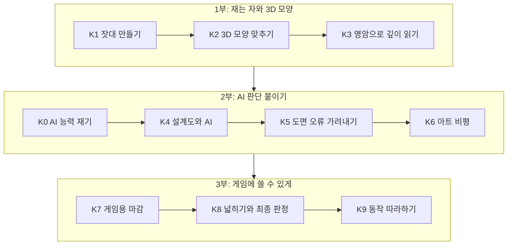
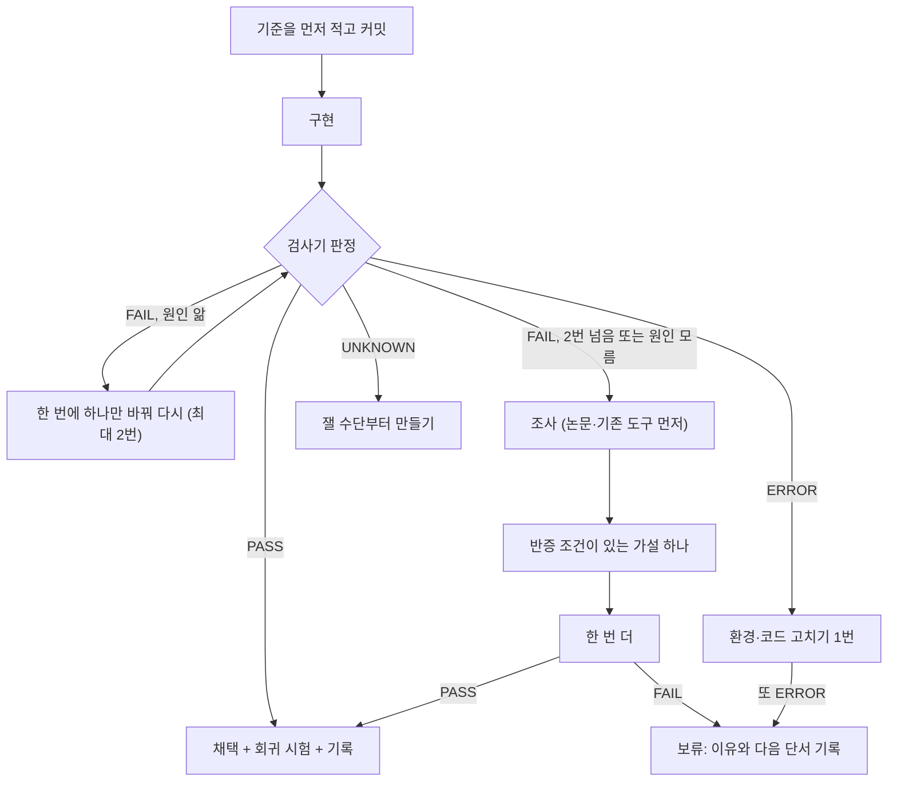

# ModelerHarness 로드맵과 계획서

> **English version: [ROADMAP.en.md](ROADMAP.en.md)** · 이 문서는 한국어판이다. 영어판과 같은 계획이고, 단계별 기준과 보류 항목을 더 자세히 적었다.

**한 줄 요약: 손그림 크리처 도면(정면·옆·뒤)을 보고, AI가 숙련 모델러처럼 "게임에 바로 쓸 수 있는 3D 모델"을 만들게 하는 것이 목표다. 합성 시험에서는 이미 이겼고, 지금은 실제 손그림에서 머리가 납작해지는 문제를 푸는 중이다.**

이 문서는 누가 읽어도 "왜 이 순서로, 무엇을 기준으로 하는지" 납득할 수 있게 썼다.
어려운 말은 꼭 필요한 것만 쓰고, 그 옆에 **쉽게 말하면** 상자를 붙였다. ▶ 표시가 있는 줄을 누르면 자세한 내용이 펼쳐진다.

마지막 고친 날: 2026-10-30 · 기준 문서: [`docs/구현계획_통합.md`](docs/구현계획_통합.md), [`docs/루프_작업목록.md`](docs/루프_작업목록.md)

---

## 목차

1. [한눈에 보기](#1-한눈에-보기)
2. [왜 만드나: 풀려는 문제](#2-왜-만드나-풀려는-문제)
3. [어떻게 푸나: 지키는 원칙 네 가지](#3-어떻게-푸나-지키는-원칙-네-가지)
4. [지금 어디까지 왔나](#4-지금-어디까지-왔나)
5. [이정표: 큰 목표 다섯 개](#5-이정표-큰-목표-다섯-개)
6. [단계별 계획 K0~K9](#6-단계별-계획-k0k9)
7. [가까운 할 일: 지금 · 다음 · 나중](#7-가까운-할-일-지금--다음--나중)
8. [판정은 어떻게 하나](#8-판정은-어떻게-하나)
9. [위험과 대응](#9-위험과-대응)
10. [하지 않기로 한 것](#10-하지-않기로-한-것)
11. [함께하기: 어디서 도울 수 있나](#11-함께하기-어디서-도울-수-있나)
12. [부록: 용어 풀이 · 옛 이름 대응 · 관련 문서](#12-부록)

---

## 1. 한눈에 보기

| 구분 | 상태 | 한 줄 설명 |
|---|---|---|
| 하네스 뼈대(MCP 서버·추적·루프 엔진) | **대부분 완료** | 시험 12/12, 11/11, 17/17 PASS. 루프 엔진에 작업 목록 옮기기만 남음 |
| 합성 크리처로 3D 만들기 | **PASS** (합성 범위) | 부피 IoU 0.92 대 옛 방식 0.59 |
| 실제 손그림 도면으로 3D 만들기 | **FAIL** (지금 막힌 곳) | 머리가 납작한 판처럼 나온다 |
| LLM 판단 능력 재기(K0) | **진행 중** | 한 모델 가족 중간 결과만 있음, 최종 판정 전 |
| 게임용 마감(리토폴로지·UV·텍스처·리깅·Godot) | **대기** | 실제 도면이 통과한 뒤 |

> [!TIP]
> **쉽게 말하면:** 먼저 "잘했는지 재는 자(K1)"를 만들고, 그 자로 재면서 모양을 만들고(K2~K3), AI의 판단을 붙이고(K4~K6), 마지막에 게임에 넣을 수 있게 다듬는다(K7~K8). 자가 없으면 "좋아졌다"를 말할 수 없어서, 순서가 중요하다.

---

## 2. 왜 만드나: 풀려는 문제

**ChatGPT·Claude 같은 AI는 말은 잘하지만, 3D 모델링에서 꼭 필요한 일 네 가지를 못 한다.**

1. **여러 장의 그림을 하나의 입체로 합치지 못한다.** 정면 그림과 옆 그림을 보고 "그러면 이 머리는 이렇게 생긴 덩어리"라고 머릿속에서 합치는 일이 약하다.
2. **정확한 숫자와 좌표를 자주 틀린다.** "뿔 끝은 x=0.31" 같은 값을 써 보라고 하면 그럴듯하지만 틀린 값을 낸다.
3. **자기 작업을 스스로 검사하지 못한다.** 만든 결과를 보고 "잘 됐다"고 말하지만, 실제로 재 보면 틀린 경우가 많다.
4. **긴 작업에서 길을 잃는다.** 단계가 길어지면 처음 목표를 잊거나, 끝나지 않았는데 "완료"라고 말한다.

그런데 사람이 3D 모델을 만들려면 비싼 도구나 큰 그래픽카드, 또는 오랜 숙련이 필요하다.
이 프로젝트는 **무료 도구와 오래된 컴퓨터**(그래픽카드 GTX 750 Ti 2GB, CPU i5-3470, 메모리 16GB)에서 이 문제를 풀려고 한다.

<b>▶ "AI를 더 똑똑하게 만들면 되지 않나?"에 대한 답</b>

우리는 AI 모델 자체를 학습시키거나 고치지 않는다. 그건 돈과 큰 컴퓨터가 필요하다.
대신 **AI 둘레에 규칙과 도구를 두른다.** 이것을 "하네스"라고 부른다.

> 💡 **쉽게 말하면:** 하네스(harness)는 말에게 씌우는 마구다. 말의 힘은 그대로 두고, 그 힘이 엉뚱한 데로 가지 않게 방향을 잡아 준다. 여기서 말은 AI, 마구는 "측정은 도구가 한다", "검사기가 통과시켜야 통과다" 같은 규칙과 도구다.

이미 바깥 연구에서도 같은 방향이 효과가 있었다. 예를 들어 CAD(기계 설계) 분야에서 AI가 쓴 결과를 측정값으로 되돌려 주며 고치게 했더니 오차(챔퍼 거리)가 28.37에서 0.74로 줄었다는 보고가 있다(CADSmith, 자세한 출처는 [`docs/진단_방향재검토.md`](docs/진단_방향재검토.md) 1.1절).

<b>▶ 첫 사용처와 최종 결과물</b>

- **첫 사용처:** 별도 게임 프로젝트의 크리처(괴물·동물) 유닛. 그 프로젝트 그림은 공개할 권리가 없어서 이 저장소에는 넣지 않는다.
- **최종 결과물:** 도면에서 출발해 **사람이 손으로 고칠 수 있고, 뼈대를 넣어 움직일 수 있는 게임 에셋**까지.
  순서는 3D 모양 → 리토폴로지(면 정리) → UV(펼치기) → 텍스처(색칠) → 리깅(뼈 넣기) → Godot 엔진에 넣기.
- 모든 단계는 **검사기가 판정**한다. 사람 눈이나 AI의 말로 통과시키지 않는다.

---

## 3. 어떻게 푸나: 지키는 원칙 네 가지

이 네 가지가 이 프로젝트의 정체성이다. 기여하는 사람(사람이든 AI든)도 똑같이 지킨다.

### 원칙 1. 판단은 AI가, 측정은 도구가

AI는 "여기는 머리, 이건 휘어진 관 모양 뿔, 이건 납작한 판 모양 귀" 같은 **이름과 종류만** 정한다.
위치·크기·각도 같은 **숫자는 도구가 그림에서 직접 잰다.** AI에게 좌표를 받는 입력 칸 자체가 없다(넣으면 거부된다).

<b>▶ 왜 이렇게까지 하나</b>

초기 실험에서 AI에게 좌표를 직접 그리게 했더니 엉뚱한 곳에 삼각형이 생겼다. 바깥 연구에서도 AI가 만든 CAD 코드는 문법은 맞아도 부품 위치나 값 하나가 틀리는 일이 흔하다고 보고됐다.
AI가 잘하는 것(이름 붙이기, 구조 이해)과 못하는 것(정밀한 숫자)을 나눠 맡기는 것이다.

### 원칙 2. 통과는 실제로 돌린 검사기만 낸다

판정은 **PASS(통과)·FAIL(실패)·UNKNOWN(모름)·ERROR(실행 오류)** 넷뿐이다.
"잘 된 것 같다"는 판정이 아니다. **기준은 돌리기 전에 글로 적고**, 실패했다고 기준을 낮추지 않는다.

<b>▶ 이 규칙으로 실제로 잡은 실수들</b>

- 부품을 합치는 과정이 본체를 통째로 지우고 있었다(정점 48,093개 → 1,912개). 겉으로는 "한 덩어리, 닫힘" 검사를 통과해 보였다.
- 같은 입력으로 다시 돌렸는데 결과가 달랐다. 앞 실행이 남긴 파일을 몰래 읽고 있었다.
- 진단할 때 쓴 숫자 자체가 틀렸다(겹친 도형 부피를 그냥 더함). 다른 방법으로 다시 재서 잡았다.

모두 "기준을 먼저 적고, 실제로 돌리고, 결과를 지문으로 비교"했기 때문에 잡혔다. 자세한 건 [`docs/수정_기록.md`](docs/수정_기록.md) 44~52번.

> 💡 **지문(fingerprint)이란:** 결과 파일 내용을 짧은 코드로 요약한 것. 같은 입력이면 같은 지문이 나와야 한다. 지문이 다르면 어딘가 숨은 변수가 있다는 뜻이다.

### 원칙 3. 조사는 코드까지 가야 한다

논문이나 도구를 조사하면 ID(예: `R-013`)를 붙이고 **채택·보류·기각·대기** 중 하나로 결정한다.
채택한 조사는 **연결된 시험이 실제로 돌아 PASS 했을 때만** "반영됨"으로 센다.

<b>▶ 왜 필요했나</b>

조사는 많이 했는데, 그중 일부(명암으로 깊이 읽기, 해부학 도구 쓰기)가 계획에서 조용히 사라진 일이 있었다. 사용자가 "해부학 도구를 쓰라고 했는데"라고 지적하고 나서야 알았다.
그래서 장부(`trace/registry.json`)와 검사기(`mh trace_check`)를 만들어, **잊힌 조사·연결 끊긴 조사를 기계가 찾게** 했다. 지금 장부에 104개 항목이 있다(채택 43·대기 38·기각 15·보류 8).

> 💡 **쉽게 말하면:** "회의에서 하기로 한 것"을 노트에 적고, 실제로 했는지 매번 체크리스트로 확인하는 것과 같다. 체크는 사람이 아니라 프로그램이 한다.

### 원칙 4. 반복 작업 규칙은 AI의 기억이 아니라 프로그램에 둔다

"기준 먼저 → 만들기 → 판정 → 실패하면 원인 찾고 다시 → 두 번 넘게 실패하면 조사 → 가설 → 한 번 더 → 그래도 안 되면 보류"라는 흐름을 **Rust로 만든 상태 기계**가 지킨다.
AI는 엔진이 "다음엔 이걸 해"라고 준 일 하나만 하고 결과를 알린다. **AI가 "PASS 했다"고 말해도 엔진은 무시하고 직접 검사를 돌린다.**

<b>▶ 상태 기계(state machine)가 뭔가</b>

> 💡 **쉽게 말하면:** 신호등 같은 것이다. "빨강 다음엔 초록" 같은 규칙이 기계에 박혀 있어서, 운전자가 깜빡해도 순서가 지켜진다. 여기서는 "실패 2번이면 조사 단계로", "기준 파일이 바뀌면 이유 없이는 거부" 같은 규칙이 박혀 있다.

---

## 4. 지금 어디까지 왔나

**합성 크리처에서는 분명히 이겼지만, 실제 손그림 한 장에서는 아직 진다.** 숫자는 모두 실제로 돌린 결과다.

### 4.1 합성 시험: PASS

3D 정답이 있는 가짜 크리처(머리·목·몸통·다리·꼬리·뿔·귀)를 프로그램으로 만들고, 그 도면을 입력으로 줬다. 절반은 일부러 도면에 오류를 넣었다. 처음 보는 확인용 과제 12개로 쟀다.

| 지표 | 새 방식(원형 맞추기 `mh fit`) | 옛 방식(두 뷰 헐) | 뜻 |
|---|---|---|---|
| 부피 IoU (높을수록 좋음) | **0.92** | 0.59 | 입체가 정답과 얼마나 겹치나 |
| 3/4 폭 비 오차 (낮을수록 좋음) | **0.02** | 0.16 | 비스듬히 봤을 때 상자처럼 각지지 않았나 |
| 거칠기 (낮을수록 좋음) | **2.0°** | 6.7° | 표면이 계단처럼 울퉁불퉁하지 않나 |

<b>▶ 이 숫자를 너무 믿으면 안 되는 이유</b>

합성 크리처의 정답도 타원체(달걀 모양)와 관을 이어 만든 것이다. 그리고 새 방식도 타원체와 관으로 모양을 만든다. **같은 재료끼리 비교하니 유리할 수밖에 없다.**
이 위험은 실행 전에 미리 적어 뒀고, 그래서 실제 손그림 시험을 따로 했다. 그 결과가 아래 4.2다.

### 4.2 실제 손그림 도면(들소 머리): FAIL

- **머리가 납작한 원판처럼 나온다.** 정면과 옆 실루엣(그림자 윤곽)만으로는 "앞뒤로 얼마나 두꺼운지"가 정해지지 않기 때문이다.
- 해부 규칙(좌우 짝 맞추기, 귀 개수)을 넣어 가짜 귀와 뿔 비대칭은 고쳤다. 하지만 머리는 여전히 얇다(가장 짧은 축 / 가장 긴 축 = 0.355).
- 작은 AI 깊이 추정 모델(Depth Anything V2 Small, CPU에서 돎)을 붙여 옆 실루엣 점수가 0.850 → 0.895로 올랐지만, 머리 두께 문제는 그대로다.

<b>▶ 왜 실루엣만으로는 깊이를 모르나</b>

> 💡 **쉽게 말하면:** 손전등으로 벽에 그림자를 비추면, 동그란 공과 납작한 접시가 정면에서는 같은 동그라미 그림자를 만든다. 옆에서 비춰도 보이지 않는 방향이 남는다. 그래서 그림자(실루엣) 말고 **그림 안쪽의 정보**(명암, 단면선)나 **"머리는 원래 이렇게 생겼다"는 상식**이 필요하다.

다음 단서는 세 가지다.
1. **명암 띠 읽기(K3):** 셀 셰이딩 그림의 밝은 면·어두운 면 경계에서 표면 방향을 거꾸로 계산한다.
2. **머리 덩어리 수 줄이기:** 지금은 머리를 여러 타원체로 쪼개다 보니, 실루엣이 말하지 않는 곳에 얇은 판이 숨어든다.
3. **AI의 구조 판단(K4):** "이건 두개골 위 공 + 주둥이 덩어리"처럼 큰 구조를 먼저 정해 준다.

### 4.3 하네스 뼈대: 대부분 완료

| 부품 | 상태 | 증거 |
|---|---|---|
| MCP 서버 `mh mcp` (AI가 쓰는 도구 14개) | PASS | `tests/selftest_mcp.py` 12/12 |
| 추적 검사기 `mh trace_check` | 자리별 PASS, 전체 FAIL | 시험 11/11 PASS. 옛 조사 29개가 아직 코드·시험과 연결 안 됨 |
| 분기 루프 엔진 `mh loop_next` | 거의 완료 | 시험 17/17 PASS. 작업 목록을 엔진 계획 파일로 옮기는 일만 남음 |

> [!NOTE]
> 추적 검사기 **전체 판정이 FAIL인 것은 정상**이다. "아직 안 한 일이 있다"는 뜻이고, 그 목록이 곧 남은 일 목록이다. 일부러 숨기지 않는다.

---

## 5. 이정표: 큰 목표 다섯 개

날짜 대신 **"무엇이 되면 끝났다고 하는지"** 로 이정표를 정한다. 일정을 지어내지 않기 위해서다(이 프로젝트는 확인 못 한 숫자를 쓰지 않는다).

| # | 이정표 | 끝났다고 하는 조건 | 상태 |
|---|---|---|---|
| ① | 합성에서 이긴다 | 확인 과제 12개에서 부피 IoU가 옛 방식 + 0.15 이상 등(아래 펼침) | **PASS** |
| ② | 실제 손그림 한 장을 통과한다 | 들소 머리: 몸 1덩어리, 납작한 판 없음, 귀 2개, 실루엣 하락 제한 | **FAIL, 진행 중** |
| ③ | AI가 붙으면 더 낫다 | AI가 MCP로 설계도를 쓴 판이 AI 없는 자동판을 이긴다 | **대기** |
| ④ | 게임에 쓸 수 있다 | 사각형 면 95% 이상, 영향 뼈 4개 이하, Godot에서 열림 | **대기** |
| ⑤ | 최종 판정 | 옛 하네스보다 점수 하락 없음 + 아트 항목 셋 이상 개선 + 사람 비교 과반 "더 낫다" | **대기** |

<b>▶ ① 합성에서 이긴다: 실행 전에 적은 기준 전부</b>

확인 과제 12개 평균, 3D 정답 대비.
- 부피 IoU ≥ 옛 방식 + 0.15 → 0.916 대 0.595 (PASS)
- 실루엣(정면·옆 평균) ≥ 옛 방식 − 0.01 → 0.966 대 0.949 (PASS)
- |3/4 폭 비 − 정답| ≤ 옛 방식 차이의 절반 → 0.022 대 0.155 (PASS)
- 거칠기 ≤ 옛 방식 → PASS
- 몸이 한 덩어리인 과제 ≥ 11/12 → PASS

이후 부드러운 이음(smooth-min)을 더해 거칠기 2.71° → 2.00°로 더 좋아졌다.

<b>▶ ② 실제 손그림 한 장: 기준과 지금 값</b>

들소 머리 실제 도면, 실행 전 기준(루프 항목 4b의 (나)).

| 기준 | 지금 값 | 판정 |
|---|---|---|
| 몸 수 1 | 3 (최신 시도 기준) | FAIL |
| 납작한 원판 없음 (짧은 축 / 긴 축 ≥ 0.35) | 0.355지만 머리가 "얇은 판 + 긴 덩어리"로 갈라짐 | FAIL (그림 확인) |
| 가짜 귀 없음 (귀 2개) | 2개 | PASS |
| 실루엣 ≥ 옛 결과(16차) − 0.03 | 정면 0.894 / 옆 0.895, 깊이 항을 붙인 최신 값 (16차 0.977 / 0.926) | FAIL |

깊이 추정을 붙인 시도(루프 항목 4d)에는 더 엄격한 기준(머리 최소 축비 ≥ 0.5, 실루엣 하락 ≤ 0.01)을 따로 적었고, 그것도 아직 FAIL이다.

<b>▶ ③~⑤ 기준 자세히</b>

- **③ AI가 붙으면 더 낫다:** 같은 과제(합성 확인 과제 + 들소)에서 "Claude Code가 MCP로 설계도를 쓰고 고친 판" 대 "AI 없는 자동 맞추기". AI 판이 들소에서 이겨야 "AI 모델링 하네스"라고 부를 근거가 생긴다. 숫자 기준은 **실행 전에 적을 예정**(아직 없음).
- **④ 게임에 쓸 수 있다(K7과 루프 항목 8):** 편집 가능한 Blender 객체로 내보낸 결과가 맞추기 결과와 부피 IoU ≥ 0.97, 리토폴로지 후 사각면 ≥ 0.95와 실루엣 하락 ≤ 0.01, 텍스처 재질별 평균 색차 ΔE < 10, 정점당 영향 뼈 ≤ 4, glTF 내보내기와 Godot 로드 확인, 리깅 준비 검사 PASS 유지.
- **⑤ 최종 판정(K8):** 과제 10개 이상에서, 지금 하네스 대비 재투영 IoU 하락 없음, 아트 항목 셋 이상 개선(두 AI 가족 일치), 사람 비교에서 과반이 "더 낫다".

---

## 6. 단계별 계획 K0~K9

단계 이름은 `K0`~`K9` 하나로 통일했다(옛 M·S·R·P 번호는 [부록](#12-부록)의 대응표 참고).
**각 단계의 기준은 돌리기 전에 문서에 적고 커밋한다.** 고칠 때는 개발 과제(dev)로, 판정은 처음 보는 확인 과제로만 한다.

> [!TIP]
> **개발 과제와 확인 과제를 나누는 이유:** 시험 문제를 미리 보고 공부하면 점수는 높지만 실력은 모른다. 그래서 고칠 때 보는 문제(개발)와 채점할 때만 보는 문제(확인)를 나눈다. 이걸 안 하면 "과적합"이라고 부르는 착각이 생긴다.

<b>▶ K0. AI 판단 능력 재기 — 진행 중</b>

**목표:** AI가 무엇을 믿고 맡길 만큼 잘 판단하는지, 무엇은 도구에 넘겨야 하는지 숫자로 가른다.

**왜:** AI가 "부위를 잘 알아본다"는 건 지금까지 가정이었다. 재지 않고 맡기면 원칙 2를 어기는 것이다.

**하는 일:** 정답을 아는 합성 그림으로 문제를 만들고, 두 AI 가족(Claude Sonnet, Codex)에게 순서를 바꿔 가며 묻는다. 답은 `judge` 도구로 모은다.

**기준(실행 전에 적음):**
1. 부위 알아보기(있다/없다, 몇 개): 정확도 ≥ 0.9이고 확정 비율 ≥ 0.8 → AI에게 맡김
2. 연산자 고르기(덩어리·관·판): 정확도 ≥ 0.9 → K4에서 AI가 고름
3. 작은 부위 보기: 확대 그림(`zoom`)이 전체 그림보다 0.5배 크기에서 +0.2 이상 정답률
4. 아트 판정(좋은 판 대 망친 판): 정확도 ≥ 0.8, 두 가족 카파 ≥ 0.6
5. 재현: 같은 문항 재현율 ≥ 0.9, 순서 뒤집힘 ≤ 0.1

**지금:** Sonnet 쪽 62문항 중간 결과는 세트1 1.0, 세트2 0.958, 세트4 1.0, 재현 1.0. 세트3은 0.5배 크기에서도 전체 그림으로 다 보여 확대 이득이 없었다(기준 3 FAIL). Codex 쪽은 실행 버그를 고쳐 다시 돌리는 중이라, **최종 판정은 아직 UNKNOWN**.

> 💡 **카파(kappa)란:** 두 채점자가 "우연히 맞을 확률"을 빼고도 얼마나 의견이 같은지 나타내는 숫자. 1이면 완전 일치, 0이면 우연 수준.

> ⚠️ 두 AI가 같은 답을 냈다고 꼭 맞는 것은 아니다. 강한 모델일수록 **실수도 서로 닮는다**는 연구가 있다. 그래서 정답을 아는 "보정 문항"을 섞어, 두 가족이 **같이 틀리는** 비율을 따로 잰다.

<b>▶ K1. 잣대 만들기 — 대부분 PASS</b>

**목표:** 이후 모든 단계가 쓸 "자"를 만든다. 실루엣만 보면 속는다는 걸 이미 확인했기 때문이다.

**새로 만든 자:**
- **3/4 폭 비:** 비스듬히(45°) 봤을 때 폭. 타원체는 약 0.71, 상자는 1에 가깝다. 상자처럼 각진 머리를 잡아낸다.
- **거칠기:** 표면의 작은 계단을 잰다. 매끈한 구 0.48°, 계단 구 20.09°로 잘 가른다(v2).
- **랜드마크 잔차:** 코끝·뿔끝 같은 이름 붙은 점이 정답에서 얼마나 벗어났나.
- **법선 그림·와이어프레임:** 색칠된 그림은 깨진 면을 숨기므로, 면 방향과 선을 직접 보는 그림.

**지금:** 시험 5개 PASS. 첫 거칠기 공식(v1)은 계단을 못 잡아 FAIL이었고, 그 사실과 숫자를 기록한 뒤 v2로 바꿨다.
**남은 것:** 세 번째 실제 머리 도면, 한 뷰에만 보이는 부위 과제, 단면 채움비 보고.

> 💡 **IoU(Intersection over Union)란:** 두 모양이 겹친 부분을 합친 부분으로 나눈 값. 1이면 완전히 같고, 0이면 전혀 안 겹친다. "부피 IoU"는 이걸 3D 입체로 잰 것이다.

<b>▶ K2. 3D 모양 맞추기(SDF 원형) — 합성 PASS, 실제 FAIL</b>

**목표:** 부위마다 알맞은 기본 도형(원형)을 골라, 도면에 맞게 크기·모양을 조절한 뒤 하나로 합친다.

**세 가지 원형(연산자):**
- **덩어리:** 머리·몸통. 달걀 모양(타원체) 여러 개.
- **관:** 뿔·다리·꼬리·목. 굵기가 변하는 휘어진 파이프.
- **판:** 귀·지느러미. 납작한 두께가 있는 면.

**맞추기 규칙:** 도면에서 보이는 픽셀만 맞추고, 다른 부위에 가려진 픽셀은 "상관없음"으로 둔다. 손그림은 뷰끼리 조금씩 안 맞으므로 작은 어긋남을 허용한다. 한 뷰에만 보이는 부위는 다른 뷰 폭을 지어내지 않고 기본 두께를 쓴다.

**합치기:** SDF 합집합 + 부드러운 이음(smooth-min). 그래서 늘 한 덩어리가 되고, 합치다 본체가 지워지는 사고가 구조적으로 안 생긴다.

**부위별 기준(실행 전에 적음):**
- K2a 뿔: 실루엣 ≥ 0.95, 부피 IoU ≥ 0.80, 거칠기 ≤ 5°, 한 덩어리
- K2b 귀: 부피 IoU ≥ 0.75, 실루엣 ≥ 0.95
- K2c 합치기: 몸 수 1, 합친 실루엣 하락 ≤ 0.01
- K2d 머리: 부피 IoU를 재기만 함(판정은 K3에서 명암 항 켬/끔 비교로)

**지금:** 전체 합성 과제는 PASS(4.1절). 부위별 K2a~K2d를 따로 판정한 기록은 아직 없어 **UNKNOWN**. 실제 들소는 FAIL(4.2절).

> 💡 **SDF(Signed Distance Field)란:** 공간의 모든 점에 "가장 가까운 표면까지 거리"를 적어 둔 지도. 안쪽은 음수, 바깥은 양수다. 도형 둘을 합칠 때 두 지도 중 작은 값만 고르면 끝이라, 복잡한 메시 합치기(불리언)보다 훨씬 안 깨진다. **smooth-min**은 그 경계를 살짝 둥글게 이어 주는 방법이다.

<b>▶ K3. 명암으로 깊이 읽기(크로스 컨투어·톤) — 대기, 지금 가장 중요</b>

**목표:** 실루엣이 말해 주지 않는 앞뒤 두께를, 그림 안쪽의 명암 띠와 단면선에서 읽는다. 들소 머리가 납작한 문제를 정면으로 겨냥한다.

**하는 일:**
1. 그림을 재질별 3단계 명암(밝음·중간·어둠)으로 나눈다.
2. 빛이 어느 방향에서 왔는지 추정한다(합성에서 오차 ≤ 10°가 목표).
3. 맞추기 점수에 "명암 띠가 맞나" 항을 더한다.
4. 부위 이름에 맞는 단면 틀(공·관·판·띠·각진 단면)을 쓰되, 근거는 단면선 > 명암 > 이름 틀 순으로 믿는다.

**기준(실행 전에 적음):** 확인 과제 머리 부피 IoU ≥ 0.80 **그리고** 명암 항을 켠 결과 − 끈 결과 ≥ +0.03. 뿔 단면은 켬이 끔보다 부피가 높고 실루엣 하락 ≤ 0.005.

> 💡 **크로스 컨투어(cross-contour)란:** 그림 위에 표면을 따라 감기는 가는 선을 그어 입체감을 보여 주는 기법이다. 수박 줄무늬처럼, 선이 휘는 모양을 보면 표면이 어디로 둥근지 알 수 있다. **톤 띠**는 셀 셰이딩 그림에서 밝은 면과 어두운 면이 나뉘는 경계다. 둘 다 "표면이 어느 쪽을 보는지(법선)"를 알려 주는 단서다. 관련 연구: CrossShade(SIGGRAPH 2012), Inverse Toon Shading.

> ⚠️ 실제 손그림의 명암은 합성처럼 규칙적이지 않다. 그래서 합성에서 통과해도 들소 그림 확인을 따로 한다.

<b>▶ K4. 설계도와 AI — 대기</b>

**목표:** AI가 "부위 목록·원형 종류·붙는 곳·좌우 짝·단면 틀·근거·확신"을 담은 **설계도(JSON)** 를 쓰고, 도구가 그대로 만든다.

**하는 일:**
- 설계도 형식: [`docs/설계도_형식.md`](docs/설계도_형식.md). 해부 정보(뼈 자리·비율)와 투시 정보도 이 안에 둔다.
- 만들기 전 검사: 단면을 비춰 도면 폭과 맞나, 좌우 짝이 대칭인가, 붙는 곳이 부모 표면 안인가.
- 부위 단위 명령(좌표 없음): `rebuild(부위)`, `section_set`, `scale_rel`, `attach`, `mirror`. **부위 하나를 바꾸면 다른 부위 지문은 그대로여야 한다.**
- 절차 카드: "크리처 머리 블록아웃 순서"처럼 숙련자의 작업 순서를 카드로(출처 적고 사람이 한 번 검토).

**기준:** 합성 6종을 설계도만으로 다시 만든 결과가 K2·K3 점수와 같거나 좋음, 부위 하나 바꾸기 시험 PASS, 실제 도면은 그림 확인.

> 💡 **쉽게 말하면:** 건축가(AI)는 "방 셋, 거실은 남쪽" 같은 설계도를 그리고, 시공사(도구)가 자로 재서 짓는다. 건축가가 벽돌 위치를 직접 정하지 않는다.

<b>▶ K5. 도면 오류 가려내기(형태 판단·의도 파악) — 대기</b>

**목표:** 도면의 각 요소를 다섯 가지로 나눈다. **정체성**(이 캐릭터의 핵심), **의도된 과장**(스타일), **불확실**, **오류**(그리다 틀림), **충돌**(뷰끼리 모순). 진짜 오류는 따라 그리지 않는다.

**왜:** 지금 방식은 모든 픽셀을 같은 무게로 맞춘다. 그래서 도면이 틀리면 **틀린 것을 정확히 복제하는 게 최선**이 되어 버린다.

**공정하게 재는 법:** 정답을 3D로 두고 도면에만 오류를 넣은 "오류 주입 과제"로 잰다(뷰 높이 어긋남, 짝 부위 비켜 그림, 귀 빼먹음, 크기 차, 턱 늘림 등).

**기준(실행 전에 적음, [`docs/설계_형태판단.md`](docs/설계_형태판단.md) 6.3):** 정밀도 ≥ 0.9, 의도된 특이함을 잘못 고침 ≤ 0.05, 재현율 ≥ 0.6, 확정 비율 ≥ 0.7, 확정 조각 정확도 ≥ 0.95.

> 💡 **정밀도와 재현율:** "오류다"라고 짚은 것 중 진짜 오류 비율이 정밀도, 진짜 오류 중 찾아낸 비율이 재현율이다. 여기선 정밀도를 더 높게 잡았다. 멀쩡한 스타일을 오류로 "고쳐" 버리는 것이 더 나쁘기 때문이다.

<b>▶ K6. 아트 비평 — 대기</b>

**목표:** "검사는 통과했지만 못생긴 모델"을 잡는다. 실제로 닫힘·한 덩어리 검사를 다 통과한 상자 머리가 나온 적이 있다.

**하는 일:** 숫자로 잴 수 있는 것은 숫자로 먼저(비율, 곡률 분포, 64px 작은 그림에서 실루엣이 읽히나, 면 방향 일관성). 숫자로 못 재는 것만 두 AI 가족에게 순서를 바꿔 두 번 묻는다. 단계당 최대 3바퀴, 한 번에 문제 하나만 고친다. 해부 규칙에서 벗어나면 **경고만** 한다(데포르메 스타일이면 도면이 이긴다).

**기준:** 좋은 판과 일부러 망친 판(비율·실루엣·형태 언어)을 항목 점수가 가려냄(두 가족 일치 ≥ 0.8), 들소 16차의 각진 머리를 "형태 언어" 항목에서 낮게 평가.

<b>▶ K7. 게임용 마감 — 대기</b>

**목표:** 만든 모양을 사람이 고칠 수 있고, 게임 엔진에서 움직일 수 있게 만든다.

**순서와 기준:**
1. **고칠 수 있는 형태로 내보내기:** 관 → Blender 커브 + 베벨, 덩어리 → 서브디비전. 슬라이더로 손본 뒤 다시 맞출 수 있게. 기준: 맞추기 결과와 부피 IoU ≥ 0.97.
2. **리토폴로지(QuadriFlow):** 사각형 면 ≥ 0.95, 실루엣 하락 ≤ 0.01. 관절 부위는 고리를 촘촘하게.
3. **UV 펼치기:** PartUV 또는 Blender 스마트 UV.
4. **텍스처:** 도면 색을 투영. 재질별 평균 색차 ΔE < 10.
5. **리깅:** 설계도의 뼈 자리에서 뼈를 만들고 자동 가중치. 정점당 영향 뼈 ≤ 4, 굽혀 보기 시험.
6. **내보내기:** glTF로 저장하고 Godot에서 열리는지 확인.

용어 풀이: 리토폴로지 · UV · 리깅 · glTF · ΔE

- **리토폴로지:** 자동으로 만든 메시는 삼각형이 들쭉날쭉하다. 애니메이션에 좋은 반듯한 사각형 그물로 다시 짜는 작업.
- **UV:** 3D 표면을 종이처럼 펼쳐 2D 그림을 붙일 수 있게 하는 것. 귤껍질을 평평하게 펴는 것과 비슷하다.
- **리깅:** 모델 안에 뼈를 넣고, 각 표면 점이 어느 뼈를 따라 움직일지 정하는 작업. "영향 뼈 4개 이하"는 게임 엔진들이 흔히 거는 제한이다.
- **glTF:** 3D 모델을 담는 공개 표준 파일 형식. "3D의 JPEG"라고도 부른다.
- **ΔE(델타 E):** 사람 눈 기준 색 차이. 대략 10 미만이면 같은 계열 색으로 보인다.

<b>▶ K8. 넓히기와 최종 판정 — 대기</b>

**목표:** 들소 한 마리가 아니라 **여러 크리처**에서 통한다는 걸 보인다.

- 과제 10개 이상, 종족별 팩 구조(도면과 부위 표만 바꾸면 되게).
- 장부 집계: 실패 유형별 개수, 교훈 검색 개선.
- **최종 판정:** 지금 하네스 대비 재투영 IoU 하락 없음, 아트 항목 셋 이상 개선(두 가족 일치), 사람 비교 과반 "더 낫다".

<b>▶ K9. 동작 따라하기(트래킹) — 조사 전</b>

**목표:** 영상 속 동물 움직임을 만든 모델에 옮기는 것. 아직 조사 단계라 **기준은 조사 뒤에 정한다(지금은 UNKNOWN).** 후보 조사 대상: MoCapAnything, QuadMocap.

---

## 7. 가까운 할 일: 지금 · 다음 · 나중

단계(K)와 별개로, 실제로 손이 가는 작업 항목은 [`docs/루프_작업목록.md`](docs/루프_작업목록.md)에서 관리한다. 번호는 그 문서의 항목 번호다.

### 지금(진행 중)

| 항목 | 무엇 | 끝나는 조건 |
|---|---|---|
| 5 · K0 | AI 판단 능력 측정 마무리 | Codex 답까지 모아 기준 1~5 판정 |
| 4g-(라) | 작업 목록을 루프 엔진 계획 파일(`loop/plan.json`)로 옮기기 | `loop_next`가 지금 할 항목을 맞게 고름 |
| 4h · 4f-① | 옛 조사 29개를 코드·시험과 연결 | `mh trace_check` 남은 문제 0 |

### 다음(지금 것이 끝나면)

| 항목 | 무엇 | 왜 이 순서 |
|---|---|---|
| K3 · 4d | 명암으로 깊이 읽기, 머리 덩어리 수 줄이기 | 이정표 ②(실제 도면)를 막는 가장 큰 원인 |
| 4h · LLM A/B | AI가 MCP로 설계도를 쓴 판 대 자동판 | 이정표 ③의 근거. K0 결과가 있어야 AI 몫을 정할 수 있음 |
| 6 · K5 | 도면 요소 5분류와 오류 무시 | 오류를 복제하지 않게 |

### 나중

| 항목 | 무엇 |
|---|---|
| 8 · K7 | 편집 가능한 Blender 출력, 리토폴로지·UV·텍스처·리깅·Godot |
| 7 | 남은 파이썬(트레이싱·빌드 파이프라인)을 Rust로 옮기기 |
| K6 · K8 · K9 | 아트 비평, 넓히기와 최종 판정, 트래킹 |

<b>▶ 보류 중인 항목과 다시 열리는 조건</b>

- **4b 해부 규칙을 들소에 적용 (나):** 검사기 자체(가)와 합성 회귀 없음(다)은 PASS. 들소 머리 두께(나)만 FAIL로 보류. K3(명암) 또는 K4(AI 구조 판단)가 끝나면 다시 연다.
- **4d 학습 모델을 사전으로:** ① 단안 깊이 추정은 "한 덩어리 안 굴곡"만 읽고 부위 사이 앞뒤는 못 읽는다(부위 안 순위 상관 0.82~0.86, 정면 전체 0.659). ② TripoSR CPU 실행 가능성 재기, ③ Hunyuan3D-2mini는 ①·②가 부족할 때만.

> 💡 **순위 상관이란:** 두 값의 "크고 작은 순서"가 얼마나 같은지. 1이면 순서가 완전히 같다. 여기서는 "AI가 추정한 앞뒤 순서"와 "정답 앞뒤 순서"를 비교했다.

---

## 8. 판정은 어떻게 하나

<b>▶ 판정 네 가지의 정확한 뜻</b>

| 판정 | 뜻 | 통과인가 |
|---|---|---|
| **PASS** | 실제로 돌린 검사기가 기준을 넘었다고 냄 | 예 (이것만) |
| **FAIL** | 돌렸고 기준에 못 미침 | 아니오 |
| **UNKNOWN** | 잴 수단이 없거나 아직 못 잼 | 아니오 |
| **ERROR** | 검사기나 환경이 고장 나서 판정 자체를 못 함 | 아니오 |

"AI가 성공했다고 말함"은 넷 중 어디에도 없다. 그건 판정이 아니다.

<b>▶ 실패했을 때의 흐름(루프 엔진이 지키는 규칙)</b>

> 💡 **반증 조건이 있는 가설이란:** "이렇게 하면 좋아질 것이다"가 아니라 "이렇게 하면 머리 부피 IoU가 0.03 이상 오를 것이다. 안 오르면 이 가설은 틀렸다"처럼, **틀렸는지 확인할 수 있게 적은 가설**이다. 틀릴 수 없는 가설은 아무것도 알려 주지 않는다.

<b>▶ 기준을 바꿔도 되는 경우와 안 되는 경우</b>

- **안 됨:** 실패하고 나서 기준을 낮추기.
- **됨:** 아직 돌리기 전에 기준을 더하거나 엄격하게 하기(예: K2a에 거칠기 ≤ 5°를 더함).
- **됨, 단 기록 필수:** 시험 방식 자체에 결함이 있었을 때. 고치되, 원래 기준 숫자와 고친 이유를 그대로 남긴다(예: K1 거칠기 v1 → v2).
- 성공 조건 자체를 바꾸는 것은 **사용자 승인**이 필요하다.

---

## 9. 위험과 대응

| 위험 | 왜 문제인가 | 대응 |
|---|---|---|
| 합성 시험이 너무 유리함 | 정답과 맞추기가 같은 도형 재료라 점수가 부풀 수 있다 | 실제 손그림 확인을 따로 판정. 공개 라이선스 도면 모집(11절) |
| 실루엣만으로 깊이를 모름 | 머리가 납작해진다(지금 막힌 곳) | K3 명암, 덩어리 수 줄이기, K4 AI 구조 판단 |
| 두 AI가 같이 틀림 | "두 가족 일치 = 맞음" 규칙이 깨질 수 있다 | 정답 아는 보정 문항으로 같이 틀리는 비율을 잼. 크면 그 규칙을 버림 |
| 점수만 쫓다 품질이 망가짐 | 실루엣 1.000을 맞추려다 부피·매끈함을 잃은 전례가 있다 | 한 점수가 아니라 진단표(부피·3/4 폭·거칠기·랜드마크·사람 비교) |
| 오래된 하드웨어 | 큰 3D 생성 모델은 못 돌린다 | 학습 모델은 결과물이 아니라 "맞추기의 참고"로만. 전용 CUDA 커널이 필요한 모델(TRELLIS 등)은 제외 |
| 공개할 수 없는 시험 도면 | 외부 기여자가 실제 도면 시험을 못 돌린다 | 공개 라이선스 크리처 도면 모집, 합성 과제는 누구나 생성 가능 |
| 하네스가 너무 복잡해짐 | 문서·카드·스킬이 늘었는데 품질은 그대로인 시기가 있었다 | 효과를 잰 것만 남김. 카드 있음/없음 비교도 할 일로 둠 |

---

## 10. 하지 않기로 한 것

같은 실수를 되풀이하지 않도록, **해 봤는데 안 된 것**과 **일부러 안 하는 것**을 적어 둔다.

<b>▶ 버린 방법(실험으로 확인함)</b>

| 방법 | 버린 이유 |
|---|---|
| 두 뷰 헐을 본체 만드는 중심으로 | 실루엣은 0.92~0.97로 맞아도 부피 0.39~0.63, 상자처럼 각짐. 지금은 맞추기의 **시작 모양**으로만 씀 |
| 둥근 헐(쓸기 + 실루엣 채우기)과 그 Rust 이식 | 정답 뿔의 47~49%만 덮음. 그냥 헐보다 나쁨 |
| 고리 케이지 확장, fitloop 2단계 다듬기 | 들소에서 이득 없음(정면 IoU 0.918 → 0.914) |
| 헐 안에 타원 단면 넣기 | +0.03뿐 |
| 표면 다듬기 5종 | 실루엣을 지키면서 계단을 못 줄임 |
| 크기 문턱으로 작은 부위 자동 SAM | 세 시험 모두 "귀만 SAM"보다 낮음 |
| "실루엣 일치 = 성공" | 일그러진 메시도 IoU 0.96이 나온다(바깥 연구 SAUCD) |

<b>▶ 일부러 하지 않는 것</b>

- **유료 API, 큰 GPU 요구:** 누구나 집에서 돌릴 수 있어야 한다.
- **AI 모델 학습·미세조정:** 하네스(규칙과 도구)로 푼다.
- **AI가 좌표·정점 값 쓰기:** 원칙 1.
- **허락 없는 남의 그림:** 다시 배포할 권리가 있는 도면만.
- **파이썬 확장:** 제어·도구 층은 Rust로. 파이썬은 Blender 안 작업(`bpy`)과 학습 모델 일꾼만.

<b>▶ 문서끼리 어긋났던 결정을 어떻게 정했나(요약)</b>

조사·설계 문서 18개에서 "하기로 한 것" 110개를 뽑아 대조했더니, 어긋나는 결정이 20건 있었다. 대표적인 것만:

- 주력 모양 표현이 여러 번 바뀜 → **Rust SDF 원형(덩어리·관·판) + 실루엣·명암 맞추기 + SDF 합치기**로 정함.
- 단계 번호 다섯 체계가 겹침 → **K0~K9 하나로.**
- 옛 성공 조건(설계서 12절)이 지금과 다른 시스템을 겨냥 → **사용자 승인**으로 옛 기록으로 두고, 지금 성공 조건은 K8 최종 판정.
- 3/4 판정을 자동 통과 조건에 넣을지 → **숫자로 보고만**, 판정은 사람 확인.
- 순서: 리토폴로지 → UV → 텍스처 → 리깅.

전체 20건은 [`docs/구현계획_통합.md`](docs/구현계획_통합.md) 1장.

---

## 11. 함께하기: 어디서 도울 수 있나

자세한 규칙과 시작 방법은 [`CONTRIBUTING.md`](CONTRIBUTING.md), AI 에이전트는 [`AGENTS.md`](AGENTS.md)를 먼저 읽는다.

| 도움이 필요한 곳 | 로드맵 자리 | 이슈 | 어울리는 분 |
|---|---|---|---|
| **도면에서 깊이 읽기**(지금 막힌 곳) | K3, 이정표 ② | [#2](https://github.com/endlessGold/ModelerHarness/issues/2) | 그래픽스·기하 개발자, 연구자 |
| **공개 라이선스 시험 도면** | 9절 위험 대응, K8 | [#3](https://github.com/endlessGold/ModelerHarness/issues/3) | 아티스트, 크리처 디자이너 |
| **고칠 수 있는 Blender 객체로 내보내기** | K7, 항목 8 | [#4](https://github.com/endlessGold/ModelerHarness/issues/4) | Blender 테크니컬 아티스트 |
| **게임용 마감**(리토폴로지·굽힘 시험·영향 뼈 4·Godot) | K7, 이정표 ④ | [#5](https://github.com/endlessGold/ModelerHarness/issues/5) | Blender 테크니컬 아티스트, 리거 |
| **Rust 이전**(트레이싱부터) | 항목 7 | [#6](https://github.com/endlessGold/ModelerHarness/issues/6) | Rust 개발자 |
| **AI 평가**(MCP로 일하는 AI 대 자동 맞추기) | K0, LLM A/B, 이정표 ③ | [#7](https://github.com/endlessGold/ModelerHarness/issues/7) | LLM·VLM 평가 경험자 |
| **추적 밀린 일**(처음 하기 좋은 일) | 항목 4h | [#1](https://github.com/endlessGold/ModelerHarness/issues/1) | 누구나 |
| **도면 요소 분류** | K5, 항목 6 | 아직 없음(이슈를 열어 맡기) | 개발자, 연구자 |
| **영어 문서** | 전체 | 아직 없음 | 두 언어를 쓰는 분 |

> [!IMPORTANT]
> 기여할 때도 같은 규칙이다. **이슈에 기준을 먼저 적고**, PR에는 기준·시험 출력·건드린 추적 ID·아직 UNKNOWN인 것을 함께 낸다. "잘 돌아가는 것 같다"는 통과가 아니다.

---

## 12. 부록

<b>▶ A. 용어 풀이 (가나다·알파벳 순)</b>

| 용어 | 쉬운 풀이 |
|---|---|
| **3/4 폭 비** | 45° 비스듬히 봤을 때의 폭을 정면 폭과 비교한 값. 둥근 모양은 약 0.71, 상자는 1에 가깝다. 각진 머리를 잡는 자 |
| **거칠기** | 표면이 계단처럼 울퉁불퉁한 정도(각도). 작을수록 매끈 |
| **결정적 도구** | 같은 입력이면 언제나 같은 결과를 내는 프로그램. AI와 달리 그때그때 다르지 않다 |
| **랜드마크** | 코끝·뿔끝처럼 이름 붙은 점 |
| **메시(mesh)** | 3D 모양을 작은 삼각형·사각형 면들의 그물로 나타낸 것 |
| **법선(normal)** | 표면의 한 점이 바라보는 방향. 빛이 어떻게 비칠지를 정한다 |
| **복셀(voxel)** | 3D 픽셀. 공간을 작은 정육면체 칸으로 나눈 것 |
| **비주얼 헐(visual hull)** | 여러 방향 그림자(실루엣)를 모두 만족하는 가장 큰 모양. 가려진 곳을 몰라 상자처럼 된다 |
| **실루엣** | 모양의 그림자 윤곽 |
| **원형(primitive)·연산자** | 덩어리·관·판 같은 기본 도형과, 그걸 만드는 명령 |
| **오류 주입 과제** | 정답 3D는 그대로 두고 도면에만 일부러 실수를 넣은 시험. 오류를 따라 그리는지 공정하게 잰다 |
| **재투영** | 만든 3D 모델을 다시 정면·옆 그림으로 찍어 원래 도면과 비교하는 것 |
| **지문** | 결과 파일을 요약한 짧은 코드. 같은 입력이면 같아야 한다 |
| **초타원체** | 달걀과 상자 사이를 조절할 수 있는 도형 |
| **카파** | 우연히 맞을 확률을 뺀 의견 일치 정도 |
| **하네스** | AI 둘레의 규칙과 도구. 힘은 그대로, 방향을 잡아 준다 |
| **IoU** | 겹친 부분 ÷ 합친 부분. 1이면 같은 모양 |
| **LLM** | 큰 언어 모델. ChatGPT·Claude 같은 AI |
| **MCP** | AI가 외부 도구를 부를 수 있게 하는 공개 약속(프로토콜). 이 프로젝트는 `mh mcp`로 도구 14개를 AI에게 준다 |
| **SDF** | 모든 점에 "표면까지 거리"를 적은 지도. 도형 합치기가 잘 안 깨진다 |
| **smooth-min** | SDF 두 개를 합칠 때 경계를 부드럽게 잇는 계산 |

<b>▶ B. 옛 단계 이름 대응표</b>

옛 문서에 나오는 이름을 지금 이름으로 바꿔 읽으면 된다.

| 옛 이름 | 지금 |
|---|---|
| M0 | 끝남(합성 2종 범위 PASS) → K1·K8이 넓힘 |
| M1·M2 (설계도·부위 연산) | K4 |
| M3·R1·R1.5 (형상·크로스 컨투어) | K2·K3 |
| M4·R4 (눈·비평) | K1(그림)·K6(비평) |
| M5·R2.5 (의도 파악) | K5 |
| M6·R5·R6 (마감) | K7 |
| R7·R8 | K9·K8 |
| P1 (Rust 계산 핵심) | 끝남(PASS 12/12) |
| P2·P5·P6 (Rust 이전) | K2 |
| P3 (둥근 헐 이식) | 하지 않음 |

<b>▶ C. 관련 문서 지도</b>

| 알고 싶은 것 | 문서 |
|---|---|
| 실행 계획의 기준(이 로드맵의 원본) | [`docs/구현계획_통합.md`](docs/구현계획_통합.md) |
| 지금 손대는 작업 항목과 분기 규칙 | [`docs/루프_작업목록.md`](docs/루프_작업목록.md) |
| 무엇이 맞고 틀렸나(냉정한 진단) | [`docs/진단_방향재검토.md`](docs/진단_방향재검토.md) |
| 고친 것과 그 이유 | [`docs/수정_기록.md`](docs/수정_기록.md) |
| 조사가 코드까지 갔는지 추적하는 법 | [`docs/추적_체계.md`](docs/추적_체계.md) |
| Rust로 옮기는 지도 | [`docs/설계_러스트.md`](docs/설계_러스트.md) |
| 설계도 JSON 형식 | [`docs/설계도_형식.md`](docs/설계도_형식.md) |
| AI 한계 조사 | [`docs/조사_LLM한계.md`](docs/조사_LLM한계.md) |

---

*이 로드맵도 같은 규칙을 따른다. 숫자는 모두 실제로 돌린 결과이고, 재지 못한 것은 UNKNOWN으로 적었다. 단계 상태가 바뀌면 이 문서와 원본 계획 문서를 함께 고친다.*
